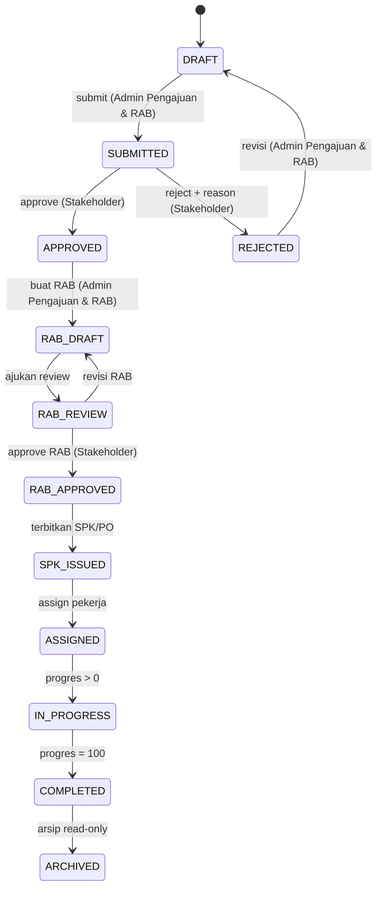

# FEATURES.md: KerjaNyata

## 1. Peta Modul & Traceability Fitur

Setiap fitur dipetakan ke requirement PRD dan keputusan produk. Dokumen ini mendefinisikan perilaku yang dapat diuji; skema database, endpoint, dan ERD didefinisikan di DATABASE.md dan API.md.

| Modul | Fitur | Req | DEC | Aktor Utama |
|:---|:---|:---|:---|:---|
| M1 Pengajuan | F-01 Buat/Edit Pengajuan | FR-01 | DEC-001 | Admin Pengajuan & RAB |
| M1 Pengajuan | F-02 Approve/Reject Pengajuan | FR-02 | DEC-001 | Stakeholder |
| M2 RAB | F-03 Draf & Review RAB | FR-03 | DEC-002 | Admin Pengajuan & RAB, Stakeholder |
| M3 SPK/PO | F-04 Penerbitan SPK/PO Berpemicu | FR-04 | DEC-003/004 | Sistem, Admin Finance |
| M3 SPK/PO | F-05 ACK SPK/PO | FR-07 | — | Stakeholder |
| M4 Penugasan | F-06 Assign Pekerja & Invoice | FR-05 | — | Admin Finance |
| M5 Progres | F-07 Update Progres Pekerja | FR-06 | DEC-005 | Pekerja |
| M6 Monitoring | F-08 Dashboard Stakeholder | FR-08 | — | Stakeholder |
| M7 Pengaturan | F-09 Konfigurasi Pemicu | FR-09 | DEC-004 | Admin |
| M8 Audit | F-10 Audit Log Transisi | FR-11 | — | Sistem |

## 2. State Machine Siklus Hidup Pekerjaan

Seluruh modul beroperasi pada satu entitas `Job` dengan status agregat. Transisi divalidasi server-side; transisi ilegal ditolak `409 Conflict`.

## 3. Spesifikasi Fitur

### F-01 — Buat/Edit Pengajuan Pekerjaan
**User Story:** Sebagai Admin Pengajuan & RAB, saya membuat pengajuan pekerjaan dengan judul, deskripsi, estimasi biaya, dan lampiran agar tercatat sebagai data konkret.

**Acceptance Criteria:**
- Field wajib: `title`, `description`, `estimatedCost` (> 0). Lampiran opsional (S3 signed URL).
- Simpan sebagai `DRAFT` dapat dilakukan berkali-kali; `submit` mengubah ke `SUBMITTED` dan mengunci edit hingga ditolak.
- Nominal `estimatedCost` disimpan sebagai `Decimal(18,2)`; mata uang `IDR` (asumsi, `TBD` konfirmasi).
- Setelah `SUBMITTED`, tombol edit nonaktif kecuali status kembali `REJECTED`.
- Sebelum `APPROVED`, akses pengajuan oleh admin gabungan hanya untuk pengajuan miliknya sendiri; Stakeholder tetap dapat melakukan review dan keputusan sesuai F-02.

**Edge Cases:** lampiran gagal upload → simpan draf tanpa lampiran + toast error; estimasi biaya kosong → blokir submit.

### F-02 — Approve/Reject Pengajuan (DEC-001)
**User Story:** Sebagai Stakeholder, saya menyetujui atau menolak pengajuan satu tingkat tanpa berjenjang.

**Acceptance Criteria:**
- Hanya Stakeholder yang dapat approve/reject; aksi tercatat `actorId`, `timestamp`, `fromStatus`, `toStatus`.
- Reject **wajib** `rejectionReason` (min 10 karakter); tanpa alasan → `422`.
- Approve langsung memindahkan `SUBMITTED → APPROVED` (tidak ada tahap kedua).
- Aksi pada status bukan `SUBMITTED` → `409`.

**Edge Cases:** dua stakeholder approve bersamaan → optimistic lock via `version`; aksi kedua ditolak `409`.

### F-03 — Draf & Review RAB (DEC-002)
**User Story:** Sebagai Admin Pengajuan & RAB, saya membuat draf RAB untuk pengajuan `APPROVED`, termasuk yang dibuat admin lain; Stakeholder me-review dan menyetujui RAB final.

**Acceptance Criteria:**
- RAB hanya dapat dibuat jika `Job.status = APPROVED`.
- Admin gabungan dapat menyusun RAB untuk semua pengajuan `APPROVED`; Admin Finance tidak dapat menyusun RAB.
- RAB memiliki `lineItems` (uraian, qty, satuan, harga satuan, subtotal); total dihitung server-side.
- Alur: `RAB_DRAFT → RAB_REVIEW` (diajukan Admin Pengajuan & RAB) → `RAB_APPROVED` (Stakeholder) atau kembali `RAB_DRAFT` (revisi).
- Review RAB oleh Stakeholder menggunakan mekanisme approval yang sama dengan F-02 (satu tingkat).

**Edge Cases:** edit RAB saat `RAB_REVIEW` diblokir; total RAB ≠ estimasi pengajuan → diperbolehkan dengan catatan `varianceNote` (TBD kebijakan).

### F-04 — Penerbitan SPK/PO Berpemicu (DEC-003/004)
**User Story:** Sebagai sistem/Admin Finance, SPK/PO diterbitkan sesuai pemicu yang dikonfigurasi tanpa mengubah kode.

**Acceptance Criteria:**
- Pemicu dibaca dari pengaturan (`Setting.spkTrigger`): `AFTER_RAB_APPROVED` atau `MANUAL_FINANCE`.
- Jika `AFTER_RAB_APPROVED`: transisi `RAB_APPROVED → SPK_ISSUED` otomatis membuat record SPK/PO.
- Jika `MANUAL_FINANCE`: Admin Finance menekan "Terbitkan SPK/PO" secara eksplisit.
- Logika pemicu terenkapsulasi di satu service (`SpkTriggerService`) — perubahan tidak menyentuh modul lain.

**Edge Cases:** pemicu diubah saat ada job `RAB_APPROVED` → job lama tidak retroaktif; hanya job baru mengikuti pemicu aktif.

### F-05 — ACK SPK/PO
**User Story:** Sebagai Stakeholder, saya meng-ACK penerbitan SPK/PO sebagai bukti persetujuan.

**Acceptance Criteria:** ACK hanya untuk `SPK_ISSUED`; mencatat `acknowledgedBy`, `acknowledgedAt`; idempoten (ACK ganda tidak membuat record baru).

### F-06 — Assign Pekerja & Invoice
**User Story:** Sebagai Admin Finance, saya meng-assign pekerja ke SPK/PO dan menerbitkan invoice.

**Acceptance Criteria:**
- Assign ≥ 1 pekerja; pekerja menerima akses baca ke job terkait.
- Invoice terkait SPK/PO: `invoiceNumber`, `amount`, `dueDate` (`TBD` nilai default), status `UNPAID → PAID`.
- Assign mengubah `SPK_ISSUED → ASSIGNED`.

**Edge Cases:** assign pekerja nonaktif → `422`; invoice ganda untuk SPK sama → `409`.

### F-07 — Update Progres Pekerja (DEC-005)
**User Story:** Sebagai Pekerja, saya meng-update progres (0–100%) beserta `notes`.

**Acceptance Criteria:**
- Field: `progressPercent` (0–100), `notes` (teks bebas).
- Submit **tidak mengunci**; edit berikutnya meng-update record yang **sama** (bukan history baru). `updatedAt` diperbarui.
- `progressPercent > 0` memicu `ASSIGNED → IN_PROGRESS`; `= 100` memicu `IN_PROGRESS → COMPLETED`.
- Hanya pekerja yang di-assign dapat update job tersebut.

**Edge Cases:** progres turun dari 100 ke < 100 → status kembali `IN_PROGRESS` (kebijakan `TBD`, default: diizinkan); update bersamaan → last-write-wins dengan `updatedAt`.

### F-08 — Dashboard Monitoring Stakeholder
**User Story:** Sebagai Stakeholder, saya melihat ringkasan seluruh proses.

**Acceptance Criteria:** kartu ringkasan jumlah per status (pengajuan, RAB, SPK/PO, invoice, progres); tabel job aktif dengan filter status & tahun; load < 2 s (LCP). Detail query di API.md.

### F-09 — Konfigurasi Pemicu SPK/PO (DEC-004)
**User Story:** Sebagai Admin, saya memilih pemicu SPK/PO dari pengaturan tanpa deploy ulang.

**Acceptance Criteria:** field `spkTrigger` (`AFTER_RAB_APPROVED` | `MANUAL_FINANCE`) tersimpan di tabel `Setting`; perubahan berlaku untuk job baru; hanya role Admin.

### F-10 — Audit Log Transisi
**Acceptance Criteria:** setiap transisi status menulis `AuditLog` (actor, `fromStatus`, `toStatus`, `timestamp`, `entityType`, `entityId`); record **immutable** (tanpa update/delete). Lihat DATABASE.md untuk skema.

## 4. Matriks Otorisasi Aksi (Ringkas)

Matriks berikut adalah target, bukan hak backend yang telah diterapkan. Role database existing tetap `ADMIN_PENGAJUAN`; perluasan akses lintas admin dan backend RAB fase 2 belum disetujui atau diterapkan.

| Aksi | Admin Pengajuan & RAB | Stakeholder | Pekerja | Admin Finance |
|:---|:---|:---|:---|:---|
| Buat/edit pengajuan | ✅ (sendiri) | — | — | — |
| Approve/reject pengajuan | — | ✅ | — | — |
| Buat/edit RAB | ✅ (semua pengajuan `APPROVED`) | — | — | — |
| Review/approve RAB | — | ✅ | — | — |
| Terbitkan SPK/PO (manual) | — | — | — | ✅ |
| ACK SPK/PO | — | ✅ | — | — |
| Assign pekerja & invoice | — | — | — | ✅ |
| Update progres | — | — | ✅ (own) | — |
| Dashboard monitoring | Read | Full | Read (own) | Read |
| Konfigurasi pemicu | — | Read | — | ✅ |

## 5. Non-Functional Acceptance (Ringkas)

| Kriteria | Target | Verifikasi |
|:---|:---|:---|
| Latensi API p95 | < 500 ms | Load test 5 endpoint esensial |
| Dashboard LCP | < 2 s | Lighthouse |
| Audit immutable | 100% transisi tercatat | Test transisi + cek `AuditLog` |
| Akses file | Signed URL, bucket privat | Test akses tanpa signature → `403` |

Nilai nominal, `dueDate` invoice, dan SLA approval = `TBD` (lihat PRD §9). Detail endpoint, payload, dan skema database: See API.md dan DATABASE.md.
